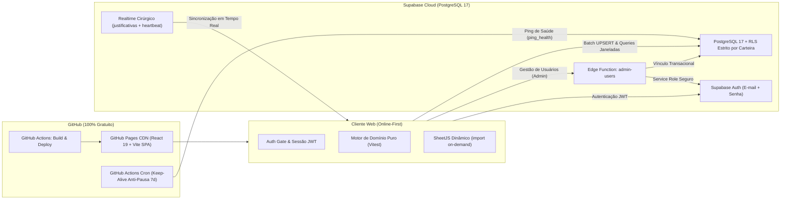

# HH Offshore Infotec v2.0

> Sistema Corporativo de Gestão de Homem-Hora (HH), Programação de Embarques e Medição Contratual Offshore para a **Infotec Brasil**.

---

## 1. Visão Geral da Arquitetura

O **HH Offshore Infotec v2.0** é uma plataforma corporativa web moderna, distribuída, reativa e de alta performance, desenvolvida sob arquitetura limpa (*Clean Frontend Architecture*) e hospedada gratuitamente via **GitHub Pages**, integrada a um backend robusto em nuvem provido pelo **Supabase (PostgreSQL 17 + Auth + Row Level Security + Edge Functions + Realtime)**.



### Princípios Arquiteturais e de Segurança
1. **Zero Dados Pessoais Versionados no Git:** Repositório 100% livre de matrículas, nomes de colaboradores ou backups operacionais. Todos os dados operacionais residem de forma restrita e encriptada no PostgreSQL do Supabase.
2. **Isolamento Multi-Escopo via Row Level Security (RLS):**
   - **Administrador & Gestor (Escopo Global):** Visualizam 100% do contrato, plataformas, prepostos e acessam módulos administrativos.
   - **Preposto & Controlador (Escopo Restrito por Carteira):** O banco de dados filtra nativamente apenas as plataformas e unidades de negócio atribuídas ao usuário logado, inclusive com exibição da Medição $\text{US}_{\text{off}}$ recortada estritamente à sua carteira.
3. **Lazy-Loading do SheetJS (`xlsx`):** A biblioteca de leitura e geração de planilhas é carregada de forma assíncrona sob demanda apenas quando o usuário importa arquivos ou exporta relatórios, reduzindo o tempo de carregamento inicial para $< 50\text{ KB}$ gzipped.
4. **Design System Infotec Brasil:** Paleta corporativa oficial em Azul (`#1E4E9C`) e Laranja (`#F5A100`), com suporte completo aos modos Claro e Escuro, tipografia `Montserrat` + `Source Sans 3` (`tabular-nums`) e acessibilidade WCAG AA.

---

## 2. Regras de Negócio e Fórmulas do Contrato

O sistema preserva integralmente as regras e métricas contratuais implementadas no projeto original:

### HH Disponível e Meta Diária
- $\text{HH Disponível} = 11{,}0\text{ h}$ por dia em que o técnico está com status embarcado na carteira de programação.
- $\% \text{ do Dia} = \frac{\text{HH Executado}}{\text{HH Disponível}} \times 100$.
- Registros abaixo de $100\%$ requerem justificativa operacional formal em até 48 horas (configurável).
- Técnicos com embarque programado sem apontamento registrado até a data de corte global recebem o status `Não chegou (conta 0 h)`, exigindo justificativa.

### Abatimento de Gangway Desconectada
- $\text{Percentual Ajustado} (\% \text{ sem gangway}) = \frac{\text{Executado}}{\max(0, \text{Disponível} - \text{Horas de Gangway Desconectada})}$.

### Ciclos e Critérios de Medição
- **Dias de Corte Suportados:**
  - Dia 21 (21 do mês anterior ao dia 20 do mês de medição);
  - Dia 1 (mês civil cheio);
  - Dia 16 (16 do mês anterior ao dia 15 do mês de medição);
  - Dia 26 (26 do mês anterior ao dia 25 do mês de medição).
- **Critérios de Relatório:**
  - `enc`: Computa exclusivamente técnicos cujo desembarque ocorreu dentro do período; o embarque é medido integralmente (incluindo dias anteriores ao corte inicial), e quem continua a bordo rola para a medição seguinte.
  - `dias`: Computa todos os dias trabalhados estritamente compreendidos dentro das datas do período.

### Medição de Unidade de Serviço Offshore ($\text{US}_{\text{off}}$)
$$\text{US}_{\text{off}} = \sum_{i=1}^{n} \left[ (\text{PE}_i \times \text{HP}_i) + (\text{EX}_i \times \text{HC}_i) \right]$$
Onde:
- $\text{HP}$: Horas Programadas da operação (do Portal Offshore ou dias $\times 11\text{ h}$);
- $\text{HC}$: Horas Cobradas (HH executado real);
- $\text{PE}$ e $\text{EX}$: Fatores de ponderação determinados em cascata hierárquica:
  1. *Linha da Operação na Planilha da Carteira*;
  2. *Tabela de Pesos por Unidade de Negócio (`config_usoff_un`)*;
  3. *Padrão Global do Contrato*.

---

## 3. Stack Tecnológica

| Camada | Tecnologia |
| :--- | :--- |
| **Frontend Framework** | React 19 + TypeScript (Strict Mode) |
| **Bundler & Build Tool** | Vite 6 |
| **Estilos & Tokens** | CSS puro modular (Tokens, Reset, Layout, Components) |
| **Ícones** | `lucide-react` |
| **Manipulação de Excel** | SheetJS (`xlsx`) via dynamic import |
| **Backend & Banco** | Supabase (PostgreSQL 17 relacional) |
| **Autenticação & RBAC** | Supabase Auth (JWT) + RLS com `SECURITY DEFINER` |
| **Serverless Functions** | Supabase Edge Functions (Deno + TypeScript) |
| **Sincronização em Tempo Real** | Supabase Realtime (WebSocket cirúrgico) |
| **Testes Unitários** | Vitest |
| **Hospedagem & CI/CD** | GitHub Pages + GitHub Actions |

---

## 4. Estrutura do Projeto

```text
├── .github/
│   └── workflows/
│       ├── deploy.yml                 # Pipeline CI/CD de build e publicação no GitHub Pages
│       └── supabase-keepalive.yml     # Cron 2x/semana anti-pausa do Supabase Free Tier
├── public/
│   └── infotec-logo.png               # Logotipo institucional oficial Infotec Brasil
├── src/
│   ├── config/
│   │   ├── constants.ts               # Constantes de regras, rótulos e ciclos
│   │   └── env.ts                     # Variáveis de ambiente públicas do Supabase
│   ├── domain/
│   │   ├── calculations.ts            # Motor matemático e de agregação de HH
│   │   ├── communications.ts          # Gerador de e-mails, alertas e deep-links Outlook Web
│   │   ├── demo.ts                    # Dados de demonstração sintéticos
│   │   ├── periods.ts                 # Resolução de janelas e ciclos de medição
│   │   ├── types.ts                   # Contratos de tipos do domínio
│   │   ├── usoff.ts                   # Motor de cálculo da USOFF
│   │   └── __tests__/                 # Suíte de testes unitários Vitest
│   ├── services/
│   │   ├── auth.service.ts            # Autenticação, escopos e gestão de acessos
│   │   ├── data.service.ts            # Queries transacionais, batch upsert e persistência
│   │   ├── excel.service.ts           # Parser de planilhas e 6 exportações XLSX
│   │   ├── realtime.service.ts        # Assinatura de eventos em tempo real
│   │   └── supabase.ts                # Cliente tipado do Supabase
│   ├── styles/
│   │   ├── components.css             # Componentes, botões, modais e badges
│   │   ├── layout.css                 # Estrutura do AppShell, Sidebar e Header
│   │   ├── reset.css                  # Normalização CSS e acessibilidade
│   │   └── tokens.css                 # Tokens Infotec Brasil Light & Dark
│   ├── types/
│   │   └── database.types.ts          # Tipos gerados do schema PostgreSQL
│   ├── ui/
│   │   ├── components/                # Componentes atômicos reutilizáveis
│   │   ├── modals/                    # Modais operacionais e lançamentos manuais
│   │   ├── state/                     # AppContext central e providers
│   │   └── views/                     # As 9 telas operacionais e administrativas
│   ├── utils/
│   │   ├── date.ts                    # Utilitários de manipulação de datas ISO/BR
│   │   └── format.ts                  # Formatação de horas, percentuais e chaves
│   ├── App.tsx                        # Roteador principal e portão de autenticação
│   └── main.tsx                       # Ponto de entrada da aplicação React
├── supabase/
│   ├── functions/admin-users/         # Edge function administrativa com service role
│   └── migrations/                    # Scripts SQL versionados com RLS e RPCs
└── vite.config.ts                     # Configuração de build para GitHub Pages
```

---

## 5. Instalação e Desenvolvimento Local

### Pré-requisitos
- **Node.js**: versão 20 ou superior (recomendado Node.js 22 LTS)
- **npm**: versão 10 ou superior

### Passos para Execução
1. Clone o repositório:
   ```bash
   git clone https://github.com/edisen12/edisen12.github.io.git
   cd edisen12.github.io
   ```
2. Instale as dependências:
   ```bash
   npm install
   ```
3. Execute o servidor de desenvolvimento:
   ```bash
   npm run dev
   ```
4. Acesse em seu navegador: `http://localhost:5173/`

### Execução dos Testes Unitários
Para rodar a suíte de testes de fidelidade contratual com Vitest:
```bash
npm run test:run
```

Para rodar em modo assistido (*watch mode*):
```bash
npm run test
```

### Compilação de Produção e Verificação de Tipos
```bash
npm run typecheck
npm run build
```
Os artefatos estáticos otimizados serão gerados na pasta `dist/`.

---

## 6. Configuração do GitHub Pages e Supabase

### Variáveis no Repositório GitHub
Para personalizar a conexão do Supabase em instâncias próprias, configure as variáveis em **Settings > Secrets and variables > Actions**:
- `VITE_SUPABASE_URL`: URL base da API do projeto Supabase (ex: `https://seu-projeto.supabase.co`).
- `VITE_SUPABASE_ANON_KEY`: Chave pública `anon` com acesso restrito a RLS.

### Publicação no GitHub Pages
O workflow `.github/workflows/deploy.yml` executa automaticamente os testes, compila o projeto e publica na branch de páginas do repositório a cada `push` na branch `main`.

---

## 7. Créditos Institucionais

- **Concepção, Fórmulas e Regras Contratuais:** Luanna de Abreu Teixeira
- **Empresa:** Infotec Brasil · Gestão de HH Offshore
- **Arquitetura & Engenharia:** Antigravity AI & Engenharia de Software
